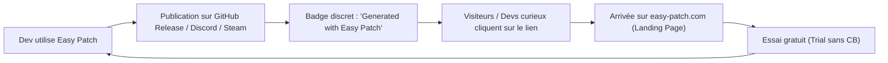
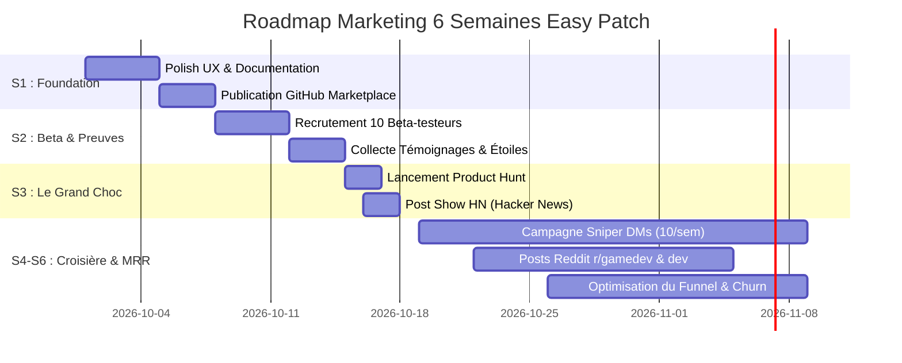

# Plan Marketing & Stratégie Growth B2B / DevTools — Easy Patch

> **Domaine :** [easy-patch.com](https://easy-patch.com)  
> **Dépôt :** `GuillaumeWalter/BetterPatcher`  
> **Auteur :** Guillaume Walter  
> **Cible de revenu :** 300 € à 1 000 € / mois de MRR (50 à 100 abonnés payants)  
> **Budget publicitaire :** 0 € gaspillé en Meta/Google Ads — Stratégie 100 % Organic & Product-Led Growth (PLG).

---

## Sommaire

1. [Positionnement & Proposition de Valeur (UVP)](#1-positionnement--proposition-de-valeur-uvp)
2. [Cibles Prioritaires & Personas](#2-cibles-prioritaires--personas)
3. [Boucle de Viralité Produit (Product-Led Growth)](#3-boucle-de-viralité-produit-product-led-growth)
4. [Les 4 Canaux d'Acquisition Organiques à 0 €](#4-les-4-canaux-dacquisition-organiques-à-0-)
5. [Boîte à Outils & Templates Prêts à l'Emploi (Copier-Coller)](#5-boîte-à-outils--templates-prêts-à-lemploi)
6. [Plan d'Action Pas à Pas (Roadmap 6 Semaines)](#6-plan-daction-pas-à-pas-roadmap-6-semaines)
7. [Modèle Financier, KPIs & Allocation Intelligente du Budget](#7-modèle-financier-kpis--allocation-intelligente)

---

## 1. Positionnement & Proposition de Valeur (UVP)

### 1.1 Slogans & Pitches

* **Slogan (One-Liner d'accroche) :**  
  > *From Git commit to community hype in 10 seconds.*  
  > (Alternative FR : *Transformez vos commits en patch notes engageants et posts réseaux en 10 secondes.*)

* **Pitch en 1 phrase :**  
  Easy Patch transforme automatiquement vos commits Git (GitHub, GitLab, SVN/Perforce) et tickets Linear en changelogs clairs et brouillons sociaux prêts à publier sur Discord, X et LinkedIn.

* **Pitch de 30 secondes (Elevator Pitch) :**  
  > « En tant que développeur ou créateur de jeu, vous passez des heures à coder, mais écrire les patch notes et annoncer vos mises à jour sur Discord, X ou Steam est une corvée qui prend 45 minutes à chaque release.  
  > **Easy Patch** élimine cette friction : connectez votre repo ou collez votre diff, choisissez le ton (Gaming, Technique ou Marketing), et Easy Patch génère instantanément un changelog structuré ainsi que vos posts sociaux préformatés pour chaque réseau.  
  > Vous pouvez même l'automatiser entièrement dans votre CI via notre GitHub Action. Vous shippez, Easy Patch s'occupe de faire rayonner votre travail. »

---

### 1.2 Grille de Différenciation Concurrentielle

| Critère / Fonctionnalité | **Easy Patch** | **ReleaseNotes.io / Headway** | **Beamer** |
| :--- | :--- | :--- | :--- |
| **Positionnement principal** | **Devs & Gaming-first** (Git + Social drafts) | SaaS B2B widgets embarqués | In-app notification widget B2B |
| **Sources d'entrée** | Commits Git (GitHub, GitLab, texte brut SVN/Perforce) + Tickets Linear | Éditeur manuel / API basique | Éditeur manuel / Dashboard lourd |
| **Génération par IA contextualisée** | **Oui** (Tons : *Gaming*, *Technical*, *Marketing*) | Non ou très sommaire | Non |
| **Distribution Multi-Canal** | **Intégrée** (Webhook/Bot Discord, formats X, LinkedIn, Steam) | Page hébergée + widget web uniquement | Widget in-app + notifications push |
| **Intégration CI/CD** | **GitHub Action officielle** & Webhook release | Non (orienté produit/marketing non-technique) | Non |
| **Pricing d'entrée** | **Gratuit / 4.99 € / mois** | 19 $ à 49 $ / mois | 49 $ à 299 $ / mois |
| **Idéal pour** | **Solopreneurs, Game Devs indés, petites équipes agiles** | Équipes produit SaaS corporate | Grands comptes B2B SaaS |

#### L'avantage concurrentiel décisif (Le "Moat")
Easy Patch ne vend pas un widget in-app statique de plus : il automatise le **pipeline complet de communication du développeur**. Les concurrents forcent le dev à reformuler manuellement ce qu'il a fait. Easy Patch extrait la vérité du code source et génère directement les formats consommables par les communautés (Discord, Steam, X).

---

## 2. Cibles Prioritaires & Personas

```
+-------------------------------------------------------------------------+
|                        PERSONAS EASY PATCH                              |
+------------------------------------+------------------------------------+
| 🎮 PERSONA A : Game Dev Indé       | 🚀 PERSONA B : Indie Hacker SaaS   |
| - Steam, itch.io, Discord          | - X/Twitter, Product Hunt, GitHub  |
| - Communauté passionnée & exigeante| - Rythme de release ultra rapide   |
| - Besoin : Ton "Gaming", Discord   | - Besoin : Gain de temps, visibilité|
+------------------------------------+------------------------------------+
| 🏢 PERSONA C : Lead Dev / CTO Agence / Studio (Cible Plan Pro à 9.99 €)  |
| - Multi-projets, tickets Linear, équipe de 2 à 5 devs                  |
| - Besoin : Homogénéité des changelogs clients, gain de 2h/semaine/dev  |
+-------------------------------------------------------------------------+
```

### Persona A : Le Game Developer Indé (Steam / itch.io)
* **Profil :** Développeur solo ou en binôme sous Unity/Unreal/Godot. Travaille souvent soirs et week-ends ou à plein temps sur son projet de cœur.
* **Canaux d'expression :** Serveur Discord communautaire, actualités Steam (Steam Community News), Reddit r/gamedev.
* **Douleur majeure :** Il déteste rédiger les annonces de build. Les joueurs réclament des nouvelles chaque vendredi. Écrire le devlog Steam et le poster sur Discord prend 1 heure pénible après une session de debug intense.
* **Bénéfice recherché :** Le ton **Gaming**, l'intégration directe Discord Webhook/Bot, et la mise en valeur des fix/features sans jargon abscons.
* **Plan type :** **Solo (4.99 € / mois)**.

### Persona B : L'Indie Hacker / Solopreneur SaaS
* **Profil :** Développeur full-stack qui conçoit, déploie et vend ses propres micro-SaaS. Très présent sur X (#buildinpublic) et LinkedIn.
* **Canaux d'expression :** X/Twitter, LinkedIn, Product Hunt, GitHub.
* **Douleur majeure :** Le manque de temps. Il sait que la rétention de son SaaS dépend de la démonstration qu'il améliore continuellement son produit, mais il a la flemme de rédiger un thread Twitter et un post LinkedIn à chaque push `main`.
* **Bénéfice recherché :** La **GitHub Action** (automatisée sur tag Git) et le studio de drafts multi-plateformes (un post technique pour GitHub, un post punchy pour X).
* **Plan type :** **Solo (4.99 € / mois)**.

### Persona C : Le Lead Dev / Studio Manager de petite agence
* **Profil :** Gère 3 à 8 projets web/mobiles ou un studio de sous-traitance logicielle (2 à 5 personnes). Utilise Linear pour le ticketing et GitLab/GitHub pour le code.
* **Canaux d'expression :** Canaux Slack/Discord clients, rapports de release bi-mensuels.
* **Douleur majeure :** Les clients demandent sans cesse *"qu'avez-vous livré ce sprint ?"*. Les devs fournissent des messages de commit illisibles (`fix bug`, `wip`). Le Lead Dev perd 2h par vendredi à regrouper les tickets Linear et rédiger un résumé propre pour les clients.
* **Bénéfice recherché :** L'agrégation **Git + Linear**, le compte partagé multi-utilisateurs (jusqu'à 5 membres), le volume de 80 générations/mois.
* **Plan type :** **Pro (9.99 € / mois)**.

---

## 3. Boucle de Viralité Produit (Product-Led Growth)

Le Product-Led Growth (PLG) permet à chaque utilisation d'Easy Patch de générer naturellement de nouveaux prospects qualifiés sans dépenser un centime.



### 3.1 La signature discrète par défaut (Watermark valorisant)
Dans le plan Gratuit (et désactivable en 1 clic dans les plans Solo/Pro) :
* Ajouter automatiquement en bas des patch notes générés :
  > `*Generated with [Easy Patch](https://easy-patch.com?utm_source=watermark&utm_medium=patchnotes)*`
* Dans les notifications Discord : intégrer un footer embed propre :
  `Easy Patch • Automate your release notes` avec lien cliquable.
* **Pourquoi ça marche ?** Les patch notes publics de GitHub et les canaux Discord `#announcements` sont lus par d'autres développeurs curieux de la stack de leurs pairs.

### 3.2 La GitHub Action sur la Marketplace GitHub (Canal passif n°1)
* Déployer l'action sous le nom officiel : **Easy Patch - Automated Patch Notes & Social Drafts**.
* Mots-clés de recherche dans la marketplace : `release-notes`, `changelog`, `discord-notification`, `git-log`, `steam-devlog`.
* Chaque repo public utilisant l'Action expose Easy Patch dans son onglet Actions et dans son code source (`.github/workflows/easypatch.yml`).

---

## 4. Les 4 Canaux d'Acquisition Organiques à 0 €

```
+--------------------------------------------------------------------------+
|                  LES 4 PILIERS D'ACQUISITION ORGANISATION                |
+-----------------------------------+--------------------------------------+
| 1. GitHub Marketplace             | 2. Lancement Communautaire           |
| Action indexée sur les recherches | Product Hunt, Hacker News, BetaList  |
| "changelog" et "release notes"    | Pic de trafic + crédibilité SEO      |
+-----------------------------------+--------------------------------------+
| 3. Infiltration de Communautés    | 4. Build in Public & DMs Ciblés      |
| Reddit (r/gamedev, r/SideProject) | 10 DMs/semaine à des devs venant     |
| Discord Devs & GameDevs           | tout juste de pusher une release     |
+-----------------------------------+--------------------------------------+
```

### Canal 1 : La GitHub Action officielle sur la GitHub Marketplace
* **Objectif :** Obtenir 50 à 150 installations de repos actifs.
* **Mécanisme :**
  1. Publier l'Action avec un fichier `action.yml` complet, une icône SVG attrayante et un `README.md` exemplaire contenant un badge visuel et un exemple YAML de 5 lignes.
  2. Ajouter les tags : `utilities`, `publishing`, `continuous-integration`.
  3. L'Action renvoie directement sur la documentation `docs.easy-patch.com` ou `easy-patch.com/docs/github-action`.

### Canal 2 : Le Lancement Communautaire (Product Hunt, Hacker News, BetaList)
* **Product Hunt :**
  - Programmer un lancement un mardi ou mercredi à 00:01 PST (09:01 heure de Paris).
  - Préparer 5 visuels 1270x760 GIF animés montrant la transformation commit -> changelog Discord.
  - Mobiliser son réseau direct dès les 2 premières heures pour sécuriser le top 5 du jour.
* **Hacker News ("Show HN") :**
  - Titre épuré sans hype marketing (HN déteste le bullshit corporate) :  
    *« Show HN: Easy Patch – Turn Git commits and Linear tickets into release notes and social drafts »*
  - Explication technique concise dans le premier post : stack (Next.js, Vercel, Supabase), choix des prompts LLM pour éviter les hallucinations de changelog, respect de la vie privée du code source.
* **BetaList & répertoires spécialisés :**
  - Soumettre à BetaList, Uneed.best, Microlaunch, Devpost, SaaSHub.

### Canal 3 : Communautés Ciblées (Reddit & Discords)
* **Subreddits prioritaires :**
  - `r/gamedev` (1.3M membres) : Angle "J'ai codé un outil pour automatiser mes devlogs Discord/Steam pour ne plus perdre 1h chaque semaine".
  - `r/SideProject` (400k membres) : Démo vidéo ultra-rapide avant/après.
  - `r/indiehackers` (150k membres) : Retour d'expérience "Comment j'ai automatisé ma communication de release".
* **Discords de Devs & GameDevs :**
  - Rejoindre les serveurs communautaires (Godot Engine, Unity Francophone / International, Indie Hackers, Game Maker's Toolkit).
  - Participer activement dans les salons `#showcase` ou `#share-your-project` en demandant des retours sur l'ergonomie.

### Canal 4 : Le "Build in Public" & Démarchage Direct Ultra-Ciblé (Sniper Outreach)
* **La tactique du "Sniper de Release" :**
  1. Suivre sur X et GitHub les créateurs de jeux indés et de micro-SaaS qui viennent d'annoncer une version `v1.2` ou `patch 0.8`.
  2. Prendre leur commit log ou leur changelog public.
  3. Générer gratuitement leur patch note formaté avec Easy Patch.
  4. Leur envoyer un message privé ultra-personnalisé et bienveillant avec le résultat tout prêt.
* **Volume :** 10 messages qualifiés par semaine (2 par jour ouvré). Taux de conversion constaté : 20 à 30 % de testeurs actifs, 5 à 10 % d'abonnés payants.

---

## 5. Boîte à Outils & Templates Prêts à l'Emploi

### Template 1 : Post Reddit (r/gamedev ou r/SideProject)
*Règle d'or Reddit : Zéro lien promotionnel agressif dès le début. Partager une douleur vécue et offrir une solution gratuite à essayer.*

```markdown
Title: I hate writing patch notes after shipping a build, so I built a tool that turns git commits into Discord & Steam changelogs in 10s

Hey everyone,

Whenever I finish a long coding / debugging session and finally build a new version, there’s always this one chore I dread: writing the community changelog. 

Looking through messy git commits, rephrasing technical bugs into player-friendly language, and formatting everything for Discord and Steam usually took me 45 painful minutes.

So a few weeks ago, I started hacking on **Easy Patch** (https://easy-patch.com).

Here’s how it works:
1. It ingests your commits (GitHub repo, GitLab, or raw diffs / SVN) or Linear tickets.
2. You pick a tone: "Gaming" (turns raw code fixes into engaging player patch notes) or "Technical".
3. It generates formatted release notes + ready-to-copy drafts for Discord (Markdown / Webhook), X, and LinkedIn.
4. There is also a GitHub Action if you want it triggered on tag push automatically.

It’s completely free to try (no credit card required). 

I’d love to get your honest thoughts:
- What platform do you usually struggle to post your updates to?
- Are there specific git tags or commit conventions you rely on?

Drop your feedback below, I'm actively improving it!
```

---

### Template 2 : Lancement Product Hunt (Kit Complet)

* **Name :** Easy Patch
* **Tagline :** Turn Git commits & Linear tickets into patch notes & social drafts
* **Topics :** Developer Tools, GitHub, Social Media, Artificial Intelligence, Indie Hackers
* **First Comment (Maker Comment) :**

```markdown
Hi Product Hunt! 👋

I’m Guillaume, creator of Easy Patch.

As developers and makers, we love shipping code. What we DON'T love is spending 45 minutes after every release writing patch notes, cleaning up commit logs, and manually writing announcements for Discord, X, and LinkedIn.

I built Easy Patch (https://easy-patch.com) to automate that entire workflow:

⚡ Key features:
- Connect your GitHub / GitLab repo, paste raw commits, or sync Linear tickets.
- AI contextualized for your audience: Gaming, Technical, or Marketing tones.
- Multi-channel Share Studio: live preview for Discord (webhook/bot), X, LinkedIn, and Steam.
- Official GitHub Action: trigger instant patch notes generation directly in your CI on release tags.

We offer a free trial so you can test it on your latest release today.

I would love to hear your feedback, feature requests, or questions in the comments! 🚀
```

---

### Template 3 : DM / Email Direct (Le Sniper de Release)
*À envoyer sur X/Twitter ou par email à un développeur qui vient de poster un changelog manuel ou une release GitHub.*

```text
Subject: Loved your latest [Nom du Projet] release / Quick question regarding patch notes

Hey [Prénom],

Congrats on shipping the latest update for [Nom du Projet]! I saw your announcement on [Twitter/Steam/GitHub].

I noticed you took the time to write down all the fixes and features manually. As a dev myself, I used to spend 45 minutes on this every Friday, so I built a tool called Easy Patch (https://easy-patch.com) that connects to Git/Linear and formats both the Discord/Steam devlog and social posts in 10 seconds.

I actually ran your public commits from your latest release through it just to test it out, and here’s what it gave for Discord:
---
[Coller ici 3-4 lignes percutantes générées par Easy Patch]
---

No sales pitch here, just thought it might save you some time on your next release. There's a free trial if you ever want to plug your repo or CI into it.

Keep up the great work on [Nom du Projet]!

Cheers,
Guillaume
```

---

### Template 4 : Post Réseau Social (LinkedIn / X) — Build in Public
*À poster par Guillaume sur son compte personnel pour démontrer la valeur du produit en situation réelle.*

```text
Every time we ship an update, we lose 30 to 45 minutes summarizing commits for our community.

Today, we just deployed v0.7 of Easy Patch. 

Here is what our release process looks like now:
1. `git push origin v0.7`
2. Our GitHub Action runs
3. 10 seconds later, our Discord community gets this formatted announcement:
[Insérer capture d'écran de l'embed Discord propre]

And our LinkedIn/X drafts are ready to review in our Share Studio.

From raw commit hashes to community excitement in seconds.

Try it on your next release: https://easy-patch.com

#buildinpublic #indiedev #devtools #gamedev #github
```

---

## 6. Plan d'Action Pas à Pas (Roadmap 6 Semaines)



### Semaine 1 : Polish Final & Soumission GitHub Marketplace
* **Objectif produit :** Parcours utilisateur sans couture de l'onboarding à la première génération.
* **Tâches clés :**
  1. Vérifier que la documentation GitHub Action (`docs/github-action.md`) est irréprochable avec des snippets YAML testés.
  2. Finaliser la fiche de l'Action sur la GitHub Marketplace (logo 256x256, descriptions claires, tags optimisés).
  3. Activer la signature discrète par défaut sur les patch notes en version gratuite.
  4. Tester le flux Stripe Checkout pour s'assurer de zéro friction lors de l'upgrade vers Solo (4.99 €) et Pro (9.99 €).

### Semaine 2 : Bêta Fermée avec 10 Développeurs & Preuve Sociale
* **Objectif :** Obtenir 3 avis élogieux, des citations (quotes) et des étoiles GitHub.
* **Tâches clés :**
  1. Contacter 10 créateurs dans son réseau ou sur Discord (5 Game Devs, 5 Indie Hackers).
  2. Leur offrir 1 mois d'accès Solo gratuit en échange d'un test en conditions réelles sur leur prochaine release.
  3. Recueillir leurs retours : bugs d'affichage, longueur des textes, formats manquants.
  4. Capturer des screenshots "avant / après" pour illustrer la future page Product Hunt.

### Semaine 3 : Lancement Public (Product Hunt & Hacker News)
* **Objectif :** Faire un pic de 500 à 1 500 visites uniques et acquérir les 15 premiers clients payants.
* **Tâches clés :**
  1. **Mardi :** Lancement Product Hunt (départ 00:01 PST). Répondre à chaque commentaire en moins de 15 minutes.
  2. **Mercredi :** Lancement Hacker News "Show HN". Partager l'approche technique sans superlatifs marketing.
  3. **Jeudi :** Soumission sur BetaList, Uneed.best et r/SideProject.
  4. Convertir les testeurs du jour via un bandeau d'offre de lancement (ex : code promo ou essai étendu).

### Semaines 4 à 6 : Routine Growth & Démarchage Direct (La machine à MRR)
* **Objectif :** Atteindre la vitesse de croisière de 300 € à 500 € / mois de MRR.
* **Routine hebdomadaire :**
  - **Lundi matin (1h) :** Veille sur les dépôts GitHub et comptes X pour identifier 10 projets venant de publier une release.
  - **Mardi & Mercredi (1h/jour) :** Envoi des 10 DMs personnalisés (Template "Sniper de Release").
  - **Jeudi (1h) :** Publication d'un post "Build in Public" sur X et LinkedIn montrant une métrique ou une amélioration de Easy Patch.
  - **Vendredi (1h) :** Analyse du churn, réponses aux tickets support, et relance des utilisateurs arrivant en fin de quota gratuit.

---

## 7. Modèle Financier, KPIs & Allocation Intelligente

### 7.1 L'Équation pour Atteindre 500 € puis 1 000 € / mois de MRR

Rappel des tarifs :
- **Plan Solo :** 4.99 € / mois TTC (environ 4.15 € HT)
- **Plan Pro :** 9.99 € / mois TTC (environ 8.30 € HT)

Supposons une répartition réaliste de **75 % Solo** et **25 % Pro** :
* Panier moyen par client (ARPU) = `(0.75 * 4.99) + (0.25 * 9.99)` = **6.24 € / mois**.

```
+-------------------------------------------------------------------------+
|                  OBJECTIFS DE CLIENTS PAYANTS (ARPU ~6.24 €)            |
+--------------------------+-----------------------+----------------------+
| Palier Visé              | Nombre d'Abonnés Solo | Nombre d'Abonnés Pro |
+--------------------------+-----------------------+----------------------+
| 300 € / mois de MRR      | ~ 36 abonnés          | ~ 12 abonnés         |
| 500 € / mois de MRR      | ~ 60 abonnés          | ~ 20 abonnés         |
| 1 000 € / mois de MRR    | ~ 120 abonnés         | ~ 40 abonnés         |
+--------------------------+-----------------------+----------------------+
```

#### Entonnoir de conversion théorique (Funnel) :
* 1 000 visiteurs uniques sur le site
* 10 % d'inscription au Trial gratuit = **100 comptes créés**
* 6 à 8 % de conversion du Trial vers un abonnement payant = **6 à 8 nouveaux clients payants**.
* **Conclusion :** Pour atteindre 80 clients payants (500 € MRR), Easy Patch a besoin d'environ 1 000 à 1 200 créations de comptes d'essai au total, facilement atteignables via la GitHub Action et les lancements communautaires.

---

### 7.2 Métriques Essentielles à Suivre (KPI Dashboard)

1. **Top of Funnel :**
   - Nombre de vues uniques sur `easy-patch.com`
   - Nombre d'installations actives de la GitHub Action
2. **Activation Produit :**
   - % d'utilisateurs inscrits qui génèrent leur premier patch note dans les 5 premières minutes (cible : > 65 %).
   - Nombre moyen de générations par utilisateur actif / mois.
3. **Monétisation & Rétention :**
   - Taux de conversion Visiteur -> Essai Gratuit (cible : 8 à 12 %).
   - Taux de conversion Essai -> Payant (cible : 5 à 8 %).
   - **Monthly Churn Rate :** Doit rester sous la barre des 6 % / mois.

---

### 7.3 Comment Dépenser Intelligemment 100 à 200 € (Sans Jamais Toucher à Google/Meta Ads)

Brûler 150 € dans Google Search Ads ou Meta Ads sur un produit à 4.99 € / mois avec un mot-clé comme "release notes generator" est une hérésie financière (le coût par clic dépassera 2 à 4 €, pour un coût d'acquisition de 40 à 80 € par client).

Voici les 3 seules allocations rentables pour un petit budget de 100 à 200 € :

1. **Micro-Sponsorship d'une Newsletter ultra-ciblée GameDev ou Indie Dev (Budget : 80 à 120 €)**
   - Exemples : Newsletters indépendantes de curateurs Godot, Unity Weekly, ou micro-newsletters Indie Hackers (1 000 à 3 000 abonnés très engagés).
   - ROI : 50 à 150 clics hyper qualifiés de développeurs en plein travail de release.

2. **Mini-Vidéo de Démo Animée / Motion Design 30s (Budget : 50 à 100 €)**
   - Passer par un freelance talentueux sur Fiverr ou Upwork pour animer l'écran avec des transitions percutantes (zoom sur le commit, sonnerie Discord, patch note qui s'affiche).
   - Cette vidéo servira indéfiniment en haut de la landing page, sur le post Product Hunt et en média épinglé sur X.

3. **Pack de Stickers "Easy Patch" et Swag pour Créateurs Influents (Budget : 30 à 50 €)**
   - Faire imprimer 50 stickers de haute qualité chez StickerApp / Stickermule.
   - Envoyer une enveloppe sympa avec 3 stickers et un mot manuscrit aux 10 premiers gros utilisateurs ou créateurs de jeux qui partagent leurs patch notes sur Twitter. Les devs adorent coller des stickers sur leurs MacBooks/PC et les prennent en photo.

---

## Conclusion & Prochaine Action Immédiate

Easy Patch possède tous les attributs d'un micro-SaaS bootstrappé gagnant :
- Une douleur réelle, fréquente et répétitive.
- Une intégration au plus près du workflow du développeur (Git & GitHub Action).
- Un prix sans friction d'achat individuel (4.99 €).

**L'unique priorité de la semaine :** Mettre l'Action en ligne sur la GitHub Marketplace et réaliser les 10 premiers DMs de test.
